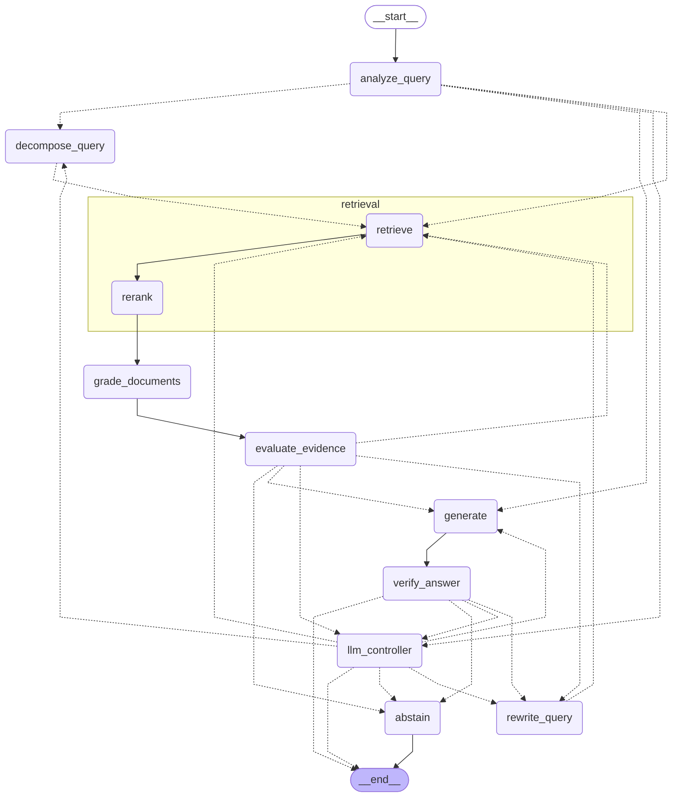
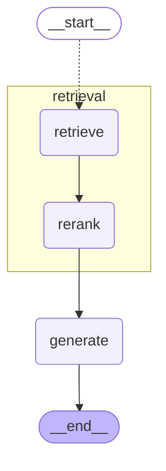

# Architecture

LangGraph orchestrates. Jev (TypeSafe's System One decision model) makes the cheap structured decisions.
A generative LLM writes text: answers, rewrites and sub-questions. In the hybrid pipeline it also re-decides
whatever Jev is unsure about.

## 1. Reference example: `notebooks/agentic_rag.ipynb`

The notebook is the architectural starting point. What it does:

| Aspect | Notebook implementation |
|---|---|
| State | `AgenticRAGState(MessagesState)` with `query`, `retrieved_docs`, `relevant_docs`, `context`, `constructed_prompt`, `generation`, `needs_retrieval`, `retrieval_count`, `max_retrieval_steps`, `is_relevant`, `rewritten_query`, `rewrite_count`, `needs_decomposition` |
| Nodes | `route_question`, `check_decomposition`, `decompose_query`, `agent` (tool-calling LLM), `tools` (`ToolNode`), `check_retrieval_limit`, `collect_tool_output`, `evaluate_docs`, `rewrite_query`, `build_prompt`, `generate` |
| Edges | `START → route_question`; `decompose_query → agent`; `tools → check_retrieval_limit`; `collect_tool_output → evaluate_docs`; `build_prompt → generate → END` |
| Conditional edges | needs retrieval? → decomposition check or build_prompt; needs decomposition? → decompose or agent; tool calls? → tools or collect; retrieval limit? → agent or collect; relevant? → build_prompt or rewrite; rewrites left? → agent or build_prompt |
| Retrieval | The `agent` LLM chooses between two tools, `vector_store_search` (Chroma + `text-embedding-3-small`) and `web_search` (Tavily) |
| Grading | One LLM structured-output call per retrieved passage (`RelevanceEvaluation.is_relevant`) |
| Rewrite | LLM rewrites the original query into a more specific one |
| Generation | `build_prompt` assembles a dynamic system prompt; `generate` answers or returns a fixed fallback |
| Loop control | `retrieval_count` against `max_retrieval_steps`, and a hard-coded `rewrite_count >= 3` |
| Compile / invoke | `graph_builder.compile()` then `graph.invoke({...})` with every counter initialised by the caller |

**Patterns kept.** Typed state, one responsibility per node, conditional edges for every decision, a
grade → rewrite → retrieve loop, counters in state checked by routers, a query-decomposition branch, and
web search as a retrieval source.

**Problems fixed.**

1. `decompose_query` overwrites `query` with the "Step 1: ... Step 2: ..." instruction. Generation then answers that text instead of the user's question. Here `query` is immutable and sub-questions live in `subquestions`.
2. The `agent` node never appends its System/Human messages to state. After the first tool call it re-invokes the LLM with only the AI and tool messages, so the system prompt and question are lost. `collect_tool_output` also walks back through every earlier cycle, because no `HumanMessage` is ever in state.
3. Every rewrite starts again from the original query, so repeated rewrites converge on the same string. Here the rewrite prompt includes every query already tried.
4. Decomposition relies on the tool-calling LLM remembering to call a tool per step. In the notebook's second example it made one retrieval and dropped half the question. Here sub-questions fan out in parallel with `Send`, one retrieval-subgraph run each.
5. Routing, grading and loop decisions are LLM calls, which are exactly the decisions Jev should make. Grading is sequential, one call per passage.
6. There was no async, no telemetry, no cost accounting, no tests and no checkpointing.

## 2. Mapping: example → this project → Jev

| Example | This project | Decided by |
|---|---|---|
| `route_question` + `check_decomposition` + the agent's tool choice | `analyze_query`: one decision returns an action (`RETRIEVE` / `DECOMPOSE` / `DIRECT_ANSWER`) and a retrieval strategy (`VECTOR` / `BM25` / `HYBRID` / `GRAPH` / `WEB`) | **Jev** (a single call with two `Choice` questions) |
| `decompose_query` | `decompose_query`, which writes `subquestions` and never touches `query` | LLM (text generation) |
| `agent` + `tools` + `collect_tool_output` | `retrieval` subgraph (`retrieve → rerank`), fanned out with `Send` | none (deterministic) |
| `evaluate_docs` | `grade_documents`, which grades only passages not graded before | **Jev** (`Noul` per passage, concurrent) |
| *(implicit in `route_after_evaluation`)* | `evaluate_evidence`: evidence status plus next action (`ANSWER` / `REWRITE` / `GRAPH_SEARCH` / `WEB_SEARCH` / `ABSTAIN`) | **Jev** (two `Choice` questions) |
| `rewrite_query` | `rewrite_query`, aware of every earlier query | LLM (text generation) |
| `build_prompt` + `generate` | `generate` with numbered, cited evidence | LLM |
| fixed fallback string | `abstain`, a grounded abstention that reports evidence status and attempts | router guard |
| none | `verify_answer`: are all claims supported? | **Jev** (`Noul`) |
| none | `llm_controller`: re-decides a low-confidence Jev decision | LLM (hybrid only) |

Jev never produces free text. It only picks from label sets that `app/agent/policies/base.py` defines once.
The Jev and LLM policies share those labels and descriptions word for word.

## 3. Graphs

Both diagrams below are generated from the compiled graphs with `ajev graph`.
`tests/test_docs.py` fails if either drifts from the code.

### Agentic graph (LLM, Jev and hybrid pipelines)



Dotted edges are conditional. Every decision node writes a `Decision` (`stage`, `action`, `confidence`,
`decided_by`) to `pending`. A single router, `route_decision`, then runs:

1. **Confidence gate.** If the policy has an `escalation_threshold` (hybrid only) and a Jev decision falls below it, route to `llm_controller`. The controller re-decides the same stage with the LLM policy and routes through the same function. LLM decisions never escalate, so this cannot loop.
2. **Guards.** Exhausted budgets override the proposed action (see section 5). So does an `ANSWER` proposed with no relevant evidence.
3. **Dispatch.** The action maps to a node through `ROUTES`. Retrieval actions return one `Send("retrieval", ...)` per active query.

### Standard RAG graph



It uses the same retrieval subgraph (fixed `HYBRID` strategy), reranker and `generate` node, with no controller.

## 4. Four pipelines, one controlled variable

| Pipeline | Graph | Policy in the runtime context | Decisions made by |
|---|---|---|---|
| `standard` | standard | none | none |
| `llm` | agentic | `LLMAgentPolicy` | LLM (expensive baseline) |
| `jev` | agentic | `JevAgentPolicy` | Jev |
| `hybrid` | agentic | `HybridAgentPolicy` | Jev, escalating below the threshold to the LLM |

The three agentic variants run the **same compiled graph** and differ only in the `AgentPolicy` passed
through LangGraph's `context`. The corpus, chunking, retrievers, reranker, generator model, prompts,
label sets and loop budgets are identical across all of them.

`AgentPolicy` (in `app/agent/policies/base.py`):

```python
async def route_query(query, meter) -> Decision               # stage "analyze"
async def grade_evidence(query, docs, meter) -> dict[id, p]   # p(relevant) per passage
async def choose_next_action(view, meter) -> Decision         # stage "evidence"
async def verify_answer(query, answer, evidence, meter) -> Decision  # stage "verify"
```

Hybrid escalation happens at two levels:

- **Routing decisions** escalate in the graph, through the `llm_controller` node, so they are visible in traces and in the Mermaid diagram.
- **Passage grades** with `|p - 0.5| < grade_uncertainty_band` are re-graded by the LLM inside `grade_evidence`. Grading filters evidence and selects no edge, so escalating it inside the node keeps the graph simple. It is still counted as `escalations.grade`.

Jev confidence comes from the API's `confidence` field for `Choice` answers. For `Noul` answers it is
`|2p - 1|`. LLM decisions are recorded with confidence 1.0.

## 5. State, reducers and loop safety

`AgentState` (`app/agent/state.py`) uses plain TypedDicts, so checkpoints serialise without registering
custom types.

| Field | Reducer | Why |
|---|---|---|
| `documents` | `merge_docs` (union by id) | parallel `Send` branches and later rounds add to one evidence pool |
| `relevance` | dict merge | each passage is graded once, which saves cost on later rounds |
| `decisions`, `rewritten_queries` | append | full decision trace for analysis |
| `metrics` | numeric sum | per-node meters add up to per-run telemetry |
| `iteration` | sum | one per decision step |
| other counters | overwrite | only the owning node writes them |

Budgets (`Settings`, all overridable as `AJEV_*` environment variables):

| Budget | Default | Enforced in |
|---|---|---|
| `max_steps` (decision steps) | 10 | `guard` |
| `max_retrieval_attempts` | 4 | `guard` (gates every retrieval action) |
| `max_rewrite_attempts` | 2 | `guard` |
| `max_decomposition_attempts` | 1 | `guard` (falls back to `RETRIEVE`) |
| `max_web_search_attempts`, `max_graph_search_attempts` | 1 each | `guard` |
| `max_verification_attempts` | 1 retry | `guard` (falls back to `ABSTAIN`) |
| `recursion_limit` | 60 | LangGraph backstop |

When a budget is spent, the router answers from the best evidence gathered so far. If there is none, it abstains.
`tests/test_graph.py` covers the bounded rewrite loop, the web-search budget and the verification retry.

## 6. Execution state vs research telemetry

| Store | Contents | Used for |
|---|---|---|
| LangGraph checkpointer: `AsyncSqliteSaver` for the CLI and eval, `InMemorySaver` for the server | full graph state at every super-step | replay, debugging, `ajev trace <thread_id>`, `/api/threads/{id}/history` |
| `runs/<run_id>/results.jsonl` | one row per (pipeline, question): answer, score, latency, calls, tokens, cost, decisions | benchmark analysis; `--run-id` resumes a run |

Nothing is copied from one store into the other. Rows carry the `thread_id` that links them.

## 7. Streaming

`trace_events` in `app/agent/graph.py` consumes `graph.astream(stream_mode=["tasks", "custom", "messages"], subgraphs=True)`
and maps the output to these events:

| Event | Source |
|---|---|
| `graph.started`, `graph.completed` | wrapper |
| `node.started`, `node.completed` | `tasks` stream, including subgraph nodes with their `scope` |
| `jev.decision`, `llm.decision`, `rule.decision` | custom events from decision nodes |
| `route.selected` | custom event from the router (includes guard overrides and escalations) |
| `retrieval.started`, `retrieval.completed`, `evidence.graded`, `query.rewritten`, `query.decomposed` | custom events |
| `llm.call`, `jev.call` | custom events from the metered service wrappers |
| `generation.token` | `messages` stream, filtered to the `generate` node |

`GET /api/stream` serves these as Server-Sent Events, and the page at `/` renders them live over the Mermaid graph.

## 8. Deliberate deviations from the initial design sketch

- **Nodes live in one module** (`nodes.py`) and routers in another (`routing.py`), not one file per node. Each node is 5–25 lines, and one file keeps the whole flow readable.
- **`route_retrieval` is folded into `analyze_query`.** Jev answers both questions in one call, and adding questions barely changes its latency. The chosen strategy is stored in `retrieval_strategy` and shown in traces.
- **No `messages` channel.** The notebook needed messages only for its tool-calling agent. Here the tool choice is a typed Jev decision, and generation takes explicit evidence.
- **One subgraph, `retrieval`.** It is shared by all four pipelines, which guarantees identical retrieval, and it is the fan-out target for multi-hop queries. Multi-hop needs no separate subgraph, because decomposition plus `Send` covers it. Verification is a single node.
- **No `choose_model`.** Fair comparison fixes the generator model across pipelines. Adaptive model selection would be a separate experiment.
- **`GRAPH` retrieval** seeds with hybrid search and expands over a chunk graph. Chunks link to page neighbours and to chunks that share a rare entity (regex extraction with an IDF filter). A separate `HYBRID_GRAPH` strategy would be identical to this, so it was dropped.
